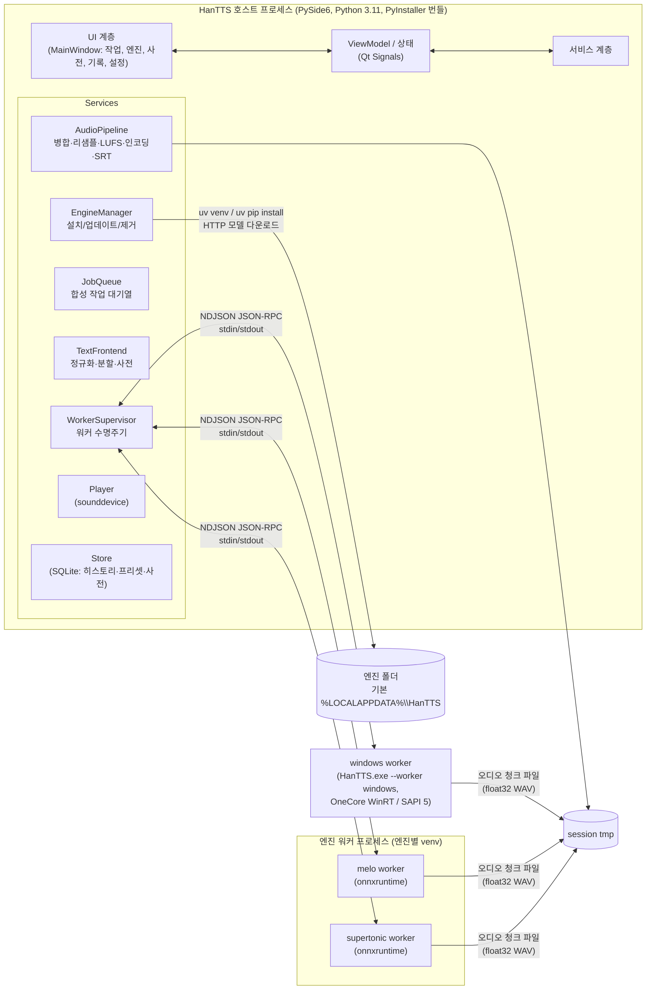
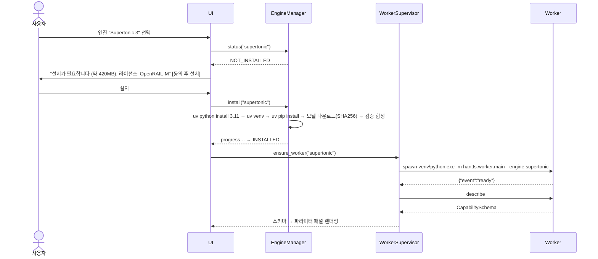

# 02. 아키텍처

## 1. 설계 원칙
1. **호스트는 가볍게, 엔진은 격리** — GUI 프로세스는 torch를 절대 import하지 않는다.
   엔진별 의존성(torch·transformers·onnxruntime 버전)이 서로 충돌하기 때문이다.
2. **엔진은 플러그인** — 모든 엔진은 같은 어댑터 인터페이스(`engines/base.py`)와 같은 IPC 프로토콜을 따른다.
3. **기능은 스키마로 선언** — 엔진이 `describe()`로 언어·음성·파라미터·기능 플래그를 JSON으로 내보내고,
   GUI는 이것만 보고 화면을 그린다. 엔진 고유 기능이 늘어나도 GUI 코드는 거의 바뀌지 않는다.
4. **필요할 때 설치** — 인스톨러에는 앱 본체, `uv.exe`, 워커 휠, 카탈로그만 넣는다. 엔진은 사용자가 고를 때 내려받는다. 설치 폴더는 마법사에서 고르고, 설정·기록은 그 폴더와 따로 `%LOCALAPPDATA%\HanTTS`에 둔다.
5. **실패해도 앱은 산다** — 워커가 죽으면 호스트가 감지해 재시작하고, 해당 작업만 실패 처리한다.

## 2. 전체 구성도



## 3. 프로세스 모델

| 프로세스 | 수 | 책임 | 기술 |
|---|---|---|---|
| Host | 1 | UI, 상태, 설치, 작업 대기열, 오디오 후처리, 재생 | PySide6 6.8+, Python 3.11, PyInstaller onedir |
| Engine Worker | 엔진당 0~1 (설정으로 상한) | 모델 로드, `describe`, `synthesize` | 엔진별 venv의 `python.exe -m hantts.worker.main` |
| Windows 음성 Worker | 0~1 | 설치된 Windows 음성 열거·합성 | **앱 실행 파일 자신** `HanTTS.exe --worker windows` (venv 없음, 다운로드 없음) |
| Installer Job | 필요 시 | `uv` 서브프로세스 실행 | uv.exe (번들) |

- 워커는 **지연 시작**: 엔진을 처음 쓸 때 기동, 모델은 첫 요청 시 로드(또는 "미리 로드" 옵션).
- **유휴 종료**: 기본 2분 미사용 시 종료해 RAM 반환. 동시에 띄울 워커 수 상한 기본 2.
- 워커 표준출력은 프로토콜 전용. 로그는 **stderr** → 호스트가 수집해 로그 파일로.
- 호스트↔워커 통신은 `QProcess`. 오디오 데이터는 파이프로 보내지 않고 **세션 임시 폴더의 WAV 청크 파일 경로**로 전달
  (대용량 base64 직렬화 회피, 디버깅 쉬움).

## 4. 워커 코드는 어떻게 엔진 venv에 들어가나
- 저장소의 `src/hantts/worker/` + `src/hantts/engines/<engine>.py` + `src/hantts/core/schema.py`를
  **`hantts_worker` 휠**로 빌드해 설치 폴더의 `wheels\hantts_worker-x.y.z-py3-none-any.whl`에 둔다.
- 엔진 설치 시 `uv pip install <엔진 패키지들> hantts_worker.whl` 로 함께 설치.
- 워커 휠은 **엔진 패키지 이외의 무거운 의존성을 갖지 않는다** (numpy, soundfile 정도).
- 앱 업데이트 시 워커 휠 버전이 바뀌면 각 엔진 venv에 워커 휠만 재설치(수 초).

## 5. 디스크 레이아웃

```
<설치 폴더>\                                ← 마법사 대상 폴더. 기본 %LOCALAPPDATA%\Programs\HanTTS
  HanTTS.exe, _internal\..., uv.exe
  wheels\hantts_worker-*.whl
  engines\catalog\catalog.json, locks\

%LOCALAPPDATA%\HanTTS\                      ← 사용자 데이터. 설치 폴더를 바꿔도 여기 유지
  config.toml                               ← engines_dir 가 엔진 저장 위치를 가리킨다
  hantts.db                                 ← SQLite (history, presets, dictionary)
  logs\host.log, logs\worker-<engine>.log
  tmp\session-<id>\                         ← 합성 청크 (앱 종료 시 정리)
  output\                                   ← 기본 출력 폴더 (변경 가능)

<엔진 폴더>\                                ← 설정·엔진 관리에서 지정. 비우면 %LOCALAPPDATA%\HanTTS
  python\                                   ← uv가 관리하는 python-build-standalone (UV_PYTHON_INSTALL_DIR)
  uv-cache\                                 ← UV_CACHE_DIR (venv 간 하드링크로 디스크 절약)
  engines\<engine_id>\
    venv\                                   ← 엔진 전용 가상환경
    engine.json                             ← 설치된 버전, 설치 시각, 매니페스트 해시, 상태
  models\<engine_id>\...                    ← 모델 가중치 (HF_HOME 등을 여기로 지정)
  voices\<engine_id>\...                    ← 사용자가 가져온 음성 (supertonic style json)
```

**중요:** 각 워커 실행 시 환경변수 `HF_HOME`, `HF_HUB_CACHE`, `TORCH_HOME`, `XDG_CACHE_HOME`, `NLTK_DATA` 등을
`models\<engine_id>\` 하위로 강제 → 엔진이 몰래 사용자 프로필(~/.cache)에 수백 MB를 받는 것을 막고, 제거 시 깔끔히 삭제.
`HF_HUB_OFFLINE=1`을 기본으로 걸어 설치 때 받은 파일만 쓰게 한다. MeloTTS는 ONNX fp32만 쓰고 BERT를 내려받지 않는다.

## 6. 저장소 구조

```
hantts/
  pyproject.toml                # 호스트 앱 (uv 프로젝트)
  src/hantts/
    __main__.py
    app/                        # Qt UI: windows/, widgets/, dialogs/, viewmodels/, resources/(qss, icons, i18n)
      main_window.py
      param_panel.py            # Capability Schema → 위젯 자동 생성
      engine_manager_view.py
      dictionary_view.py  history_view.py  settings_view.py
      wizard.py
    core/
      schema.py                 # ★ 호스트·워커 공용 계약 (pydantic 금지: 워커 의존성 최소화 → dataclasses)
      paths.py  config.py  store.py  logging.py
      catalog.py                # 엔진 카탈로그 로드/검증
      installer.py              # uv 호출, 다운로드, SHA256, 롤백
      supervisor.py             # QProcess 기반 워커 관리
      jobs.py                   # JobQueue
      text/                     # normalize_ko.py, splitter.py, dictionary.py, detect.py
      audio/                    # merge.py, resample.py, loudness.py, encode.py, srt.py, player.py
    engines/                    # ★ 워커 쪽 어댑터 (hantts_worker 휠에 포함)
      base.py
      supertonic.py  melo.py  windows.py
    worker/
      protocol.py  main.py
    cli.py                      # hantts-cli
  worker_pkg/pyproject.toml     # hantts_worker 휠 빌드 정의 (engines/, worker/, core/schema.py만 포함)
  engines/catalog/catalog.json  # 엔진 설치 레시피 (04 문서)
  installer/hantts.iss  build.ps1
  tests/
  docs/
```

## 7. 핵심 시퀀스

### 7.1 엔진이 없을 때 합성 요청


### 7.2 긴 텍스트 합성
1. `TextFrontend`: 사전 적용 → 정규화 → 문장 분할 → 엔진 `max_chars` 기준 청크화
2. `JobQueue`가 청크마다 `synthesize` 요청(순차, 엔진이 batch 지원 시 묶음)
3. 워커가 청크 WAV 경로 + 길이 반환 → 진행률 이벤트
4. `AudioPipeline`: 청크 사이 무음 삽입 → 병합 → (옵션) 리샘플·LUFS 정규화 → 인코딩 → SRT 생성
5. 히스토리에 저장, 플레이어에 로드

### 7.3 워커 장애
- 프로세스 종료 감지 → 그 문장을 최대 2번 다시 요청(워커 재시작 후) → 그래도 실패하면 작업을 중단. 지수 백오프로 재시작(최대 3회) → 실패 지속 시 엔진 상태 `BROKEN` 표시 + "복구" 버튼

## 8. 기술 스택 결정과 이유

| 결정 | 선택 | 이유 / 대안 |
|---|---|---|
| GUI | **PySide6 (Qt 6)** | 엔진들이 Python 생태계 → 한 언어로 통일, Cursor 생산성 높음, LGPL. 대안 Tauri/Electron은 별도 런타임과 IPC가 한 겹 더 생김 |
| 호스트 패키징 | **PyInstaller onedir** | 안정적. 시작 속도 개선이 필요하면 Nuitka로 교체 가능(코드 변경 없음) |
| 엔진 환경 | **uv + python-build-standalone** | 사용자 PC에 Python 설치 불필요, 매우 빠른 설치, 캐시 하드링크로 torch 중복 저장 최소화 |
| 엔진 런타임 | Supertonic·Melo는 워커 venv의 ONNX Runtime, Windows 음성은 WinRT | 호스트 번들에는 torch·onnxruntime을 넣지 않는다 |
| IPC | **NDJSON JSON-RPC over stdio** | 포트 충돌·방화벽 경고 없음, 구현 단순 |
| 오디오 I/O | soundfile(libsndfile), numpy, soxr(리샘플), pyloudnorm, sounddevice | 최신 soundfile 휠의 libsndfile은 MP3 쓰기를 지원 → ffmpeg 불필요 (Phase 0에서 확인) |
| 저장소 | SQLite (표준 라이브러리) | 히스토리·프리셋·사전 |
| 설정 | TOML (`tomllib` + `tomli-w`) | 사람이 읽을 수 있음 |
| 인스톨러 | **Inno Setup 6** | 사용자 단위가 기본. 대상 폴더 페이지에서 설치 위치를 고른다. 한국어 UI |
