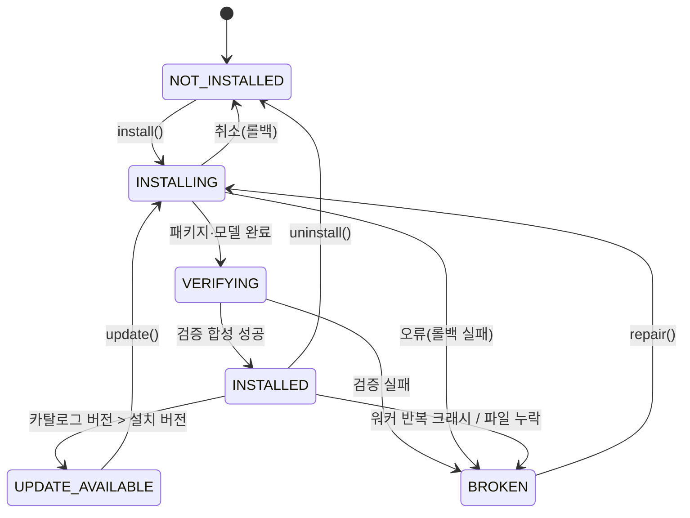
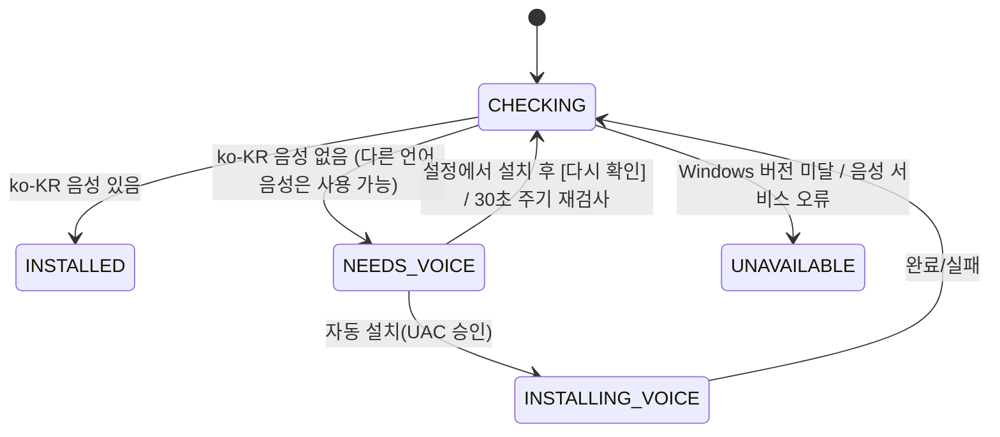

# 04. 엔진 매니저 (다운로드 · 설치 · 업데이트 · 제거)

## 1. 상태 머신



## 2. 설치 파이프라인 (단계마다 진행률 이벤트)

| # | 단계 | 동작 | 가중치(진행률) |
|---|---|---|---|
| 1 | 사전 점검 | 디스크 여유(필요량×1.3), 쓰기 권한, 네트워크/프록시, 경로에 비ASCII 문자 경고 | 2% |
| 2 | 라이선스 동의 | 카탈로그 `licenses[]` 표시. `default_checked` 항목은 처음부터 체크. `requires_consent` 항목은 체크 필수 | – |
| 3 | Python 준비 | `uv python install <ver>` (UV_PYTHON_INSTALL_DIR=데이터\python) | 8% |
| 4 | venv 생성 | `uv venv engines\<id>\venv --python <ver>` (임시 이름 `venv.new`) | 2% |
| 5 | 패키지 설치 | `uv pip install --python venv.new\Scripts\python.exe -r <lock> hantts_worker.whl` | 40% |
| 6 | 모델 다운로드 | HTTP 범위 요청(이어받기), 미러 순회, **SHA256 검증** | 40% |
| 7 | 후처리 | 예: `python -m unidic download` 대체 파일 배치 | 3% |
| 8 | 검증 | 워커 기동 → `describe` → 짧은 문장 합성 → 길이>0, NaN 없음 | 5% |
| 9 | 커밋 | `venv.new` → `venv` 원자적 교체, `engine.json` 기록 | – |

- 모든 단계는 **취소 가능**. 취소/실패 시 `venv.new`, 부분 다운로드(`*.part`) 삭제 후 이전 상태 복원.
- 패키지 설치 출력(uv stdout/stderr)을 실시간으로 "자세히 보기" 로그 창에 스트리밍.
- 우선 `uv pip compile`로 만든 **엔진별 잠금 파일**(`engines/catalog/locks/<id>-win_amd64.txt`, 해시 포함 `--generate-hashes`)을 쓴다 → 재현성.
- torch 엔진은 현재 카탈로그에 없다. Supertonic·Melo 잠금은 ONNX Runtime을 쓰고, Melo 합성은 `melotts_kr.onnx`만 사용한다.

## 3. 카탈로그(매니페스트) 형식 — `engines/catalog/catalog.json`

```jsonc
{
  "schema_version": 1,
  "catalog_version": "2026.11.1",
  "engines": [
    {
      "id": "supertonic",
      "display_name": "Supertonic 3",
      "version": "3.0.0",
      "korean_support": "official",           // official | experimental | none
      "python": "3.11",
      "runtime": "onnx",
      "approx_disk_mb": 520,
      "approx_ram_mb": 900,
      "lock_file": "locks/supertonic-win_amd64.txt",
      "extra_index_urls": [],
      "post_install": [],
      "assets": [
        {
          "dest": "models/supertonic/onnx/text_encoder.onnx",
          "sha256": "<Phase 0에서 수집>",
          "size": 0,
          "urls": [
            "https://huggingface.co/Supertone/supertonic-3/resolve/3cadd1ee6394adea1bd021217a0e650ede09a323/onnx/text_encoder.onnx",
            "https://<자체 미러>/supertonic-3/onnx/text_encoder.onnx"
          ]
        }
      ],
      "licenses": [
        {"name": "OpenRAIL-M (model weights)", "url": "…", "requires_consent": true},
        {"name": "MIT (sample code)", "url": "…", "requires_consent": false}
      ],
      "worker_env": {"HF_HUB_OFFLINE": "1"}
    }
  ]
}
```

- 카탈로그는 앱에 동봉 + (옵션) 원격 최신 카탈로그를 서명 검증 후 갱신 (ed25519 공개키를 앱에 내장).
- 선택 설치 자산(추가 음성 등)은 `optional_assets[]`로 분리할 수 있다 (v1 엔진에는 없음, 구조만 유지).
- `runtime: "builtin"` 엔진(Windows 음성)은 venv·자산이 없고 `requirements`(예: 한국어 음성 존재)만 검사한다 → §8.
- Hugging Face URL은 반드시 **커밋 해시 고정**(`resolve/<sha>/…`), `main` 금지.

## 4. 다운로더 요구사항
- `httpx`(HTTP/2 off 가능) 스트리밍, 1MB 청크, `Range` 이어받기, 지수 백오프 재시도 3회 후 다음 미러
- 시스템 프록시 자동 감지(WinINet) + 수동 설정, 사용자 CA(사내망) 지원: `truststore` 사용
- HF 미러 설정 시 `huggingface.co` 호스트를 치환 (예: 사내 미러)
- 동시 다운로드 2개, 전체 대역폭 제한 옵션
- 다운로드 중 앱 종료 → 다음 실행 시 "이어서 설치" 제안

## 5. 오프라인 엔진 팩 (`.htpack`)
- zip 구조: `pack.json`(엔진 id, 버전, 카탈로그 조각, 서명) + `wheels/*.whl` + `python/cpython-3.11-*.tar.gz` + `assets/...`
- 설치 시 `uv pip install --no-index --find-links wheels\` 로 인터넷 없이 설치
- 빌드 도구: `tools/make_pack.py --engine supertonic` (CI에서 생성, GitHub Release에 업로드)

## 6. 제거 / 업데이트
- 제거: 워커를 끝낸 뒤 `engines\<id>`, `models\<id>`, `voices\<id>` 를 삭제한다(사용자 가져온 음성은 확인 후). 파일이 잠겨 있으면 오류를 보여주고 카드 상태는 그대로 둔다. 설치가 성공하면 uv 캐시를 비운다. 실패하면 캐시를 남겨 재시도를 돕고, 그때는 "캐시 정리" 버튼으로 지운다.
- 업데이트: 새 venv를 `venv.new`로 완전 설치·검증 후 교체 → 실패해도 기존 엔진 그대로 사용 가능.
- 앱 업데이트로 워커 휠만 바뀐 경우: `uv pip install --reinstall hantts_worker.whl`만 수행 (빠른 경로).

## 7. 디스크 예상 (Phase 0에서 실측 후 갱신)
| 엔진 | 패키지 | 모델 | 합계(대략) |
|---|---|---|---|
| Supertonic 3 | ~120MB (onnxruntime 등) | ~400MB | ~0.5GB |
| MeloTTS (ONNX fp32, 현재) | ~80MB (onnxruntime, g2pkk, mecab-ko 사전) | 170MB 모델 + symbols/config/vocab. BERT 가중치 없음 | ~0.3GB |
| Windows 음성 | 0 (앱 본체에 PyWinRT·comtypes 수 MB 포함) | 0 (Windows 음성 팩은 Windows가 관리) | 0 |

설치 도중에는 uv 캐시 하드링크로 같은 휠을 venv와 공유한다. 커밋이 끝나면 캐시만 지워 디스크에 휠이 두 번 남지 않게 한다.

## 8. 내장 엔진(Windows 음성) 상태 관리
Windows 음성은 내려받을 것이 없으므로 위 설치 파이프라인을 쓰지 않는다. 대신 상태를 **검사**한다.



| 동작 | 구현 |
|---|---|
| 검사 | 워커 `list_voices` → `language == "ko-KR"` 음성 유무. 백엔드별(OneCore/SAPI)로 따로 집계 |
| 설정에서 설치 | `QDesktopServices.openUrl("ms-settings:speech")` (관리자 불필요) |
| 자동 설치 | `ShellExecuteW(None, "runas", "powershell.exe", "-NoProfile -Command Add-WindowsCapability -Online -Name 'Language.TextToSpeech~~~ko-KR~0.0.1.0'")` → 종료 코드·`Get-WindowsCapability` 재확인. 설치 대화상자(D1)는 "Windows가 음성 팩을 설치하는 중" 무한 진행 표시 |
| 실패 처리 | UAC 거부 → NEEDS_VOICE 유지 + 설정 열기 안내. 그룹 정책 차단/오프라인 → 오류 문구 + IT 관리자 안내 |
| 제거 | 앱에서 제공하지 않음 (Windows 설정에서 관리) |

카탈로그 항목: `"runtime": "builtin"`, `"requirements": [{"type": "voice_language", "lang": "ko-KR"}]`, `assets: []`.
